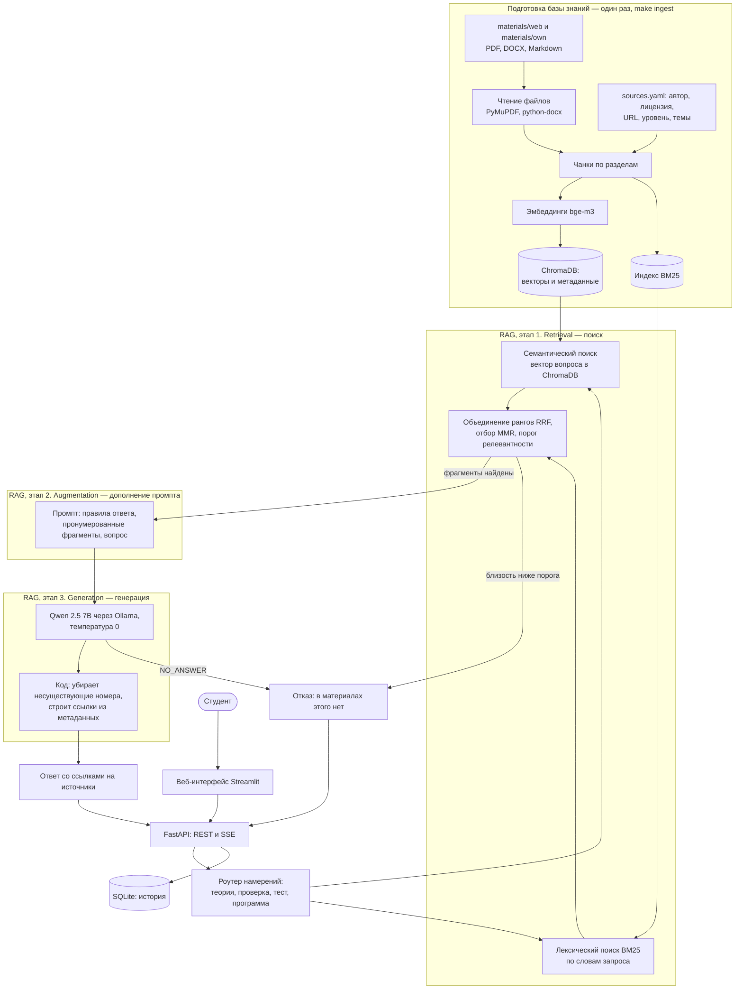
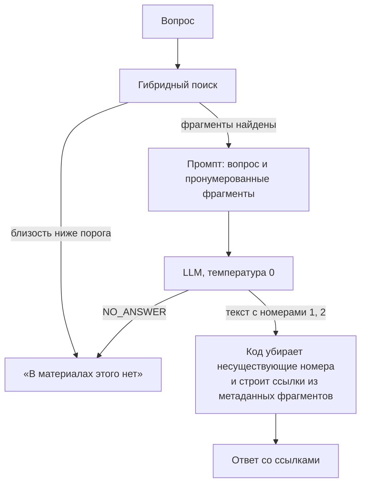

# English Tutor AI — репетитор по английскому на RAG и локальной LLM

Агент-репетитор для русскоязычных студентов уровней A1–B1 (CEFR). Объясняет по-русски, примеры и
задания даёт на английском. Работает полностью локально: модель, эмбеддинги и база — на своём компьютере.

Главный принцип: **единственный источник теории — файлы из `materials/`**. Агент отвечает только по
найденным фрагментам, под каждым ответом показывает источники и прямо говорит «В материалах этого нет»,
если ответа там нет.

## Что умеет

| Сценарий | Что делает |
|---|---|
| Вопрос по теории | Находит фрагменты материалов, отвечает по ним со ссылками `[1]`, `[2]`; по клику открывается сам фрагмент, файл, раздел, URL и лицензия |
| Проверка работы | Находит ошибки в тексте студента: фрагмент → исправление → тип → объяснение → ссылка на правило в материалах; ставит оценку и примерный уровень CEFR |
| Тест | Составляет тест по теме и уровню (выбор ответа, пропуски, исправление ошибок, перевод), проверяет ответы и показывает разбор |
| Программа обучения | Собирает план по уровням (например, «до A2»): темы по порядку, к каждой — материалы из библиотеки и переход к тесту; темы без материалов помечает |
| История и библиотека | Прошлые проверки и тесты, результаты по темам; список материалов с уровнями, темами и лицензиями |

## Инструкция по запуску

### Что нужно заранее

- macOS или Linux, 16 ГБ памяти, около 10 ГБ свободного места.
- Python 3.11+ и [uv](https://docs.astral.sh/uv/) — менеджер зависимостей.
- [Ollama](https://ollama.com/download) на самом компьютере, не в контейнере. На macOS это обязательно:
  Docker не даёт доступа к GPU, и модель в контейнере работает в несколько раз медленнее.
- Docker с Compose — только если хотите запускать в контейнерах.

### Шаг 1. Получить проект и поставить зависимости

```bash
git clone https://github.com/Xlemon5/english-tutor-ai.git
cd english-tutor-ai
uv sync                  # создаёт .venv и ставит зависимости
cp .env.example .env     # настройки по умолчанию подходят для локального запуска
```

### Шаг 2. Запустить Ollama и скачать модели

```bash
ollama serve                             # отдельное окно терминала; пропустите, если Ollama уже запущена
ollama pull qwen2.5:7b-instruct-q4_K_M   # языковая модель, 4,7 ГБ
ollama pull bge-m3                       # модель эмбеддингов, 1,2 ГБ
```

Проверка: `ollama list` должен показать обе модели.

### Шаг 3. Проиндексировать материалы

```bash
make ingest
```

Первый раз это занимает около 15 минут: около 5000 фрагментов проходят через модель эмбеддингов. В конце
появится строка вида «проиндексировано файлов: 477 … Всего чанков в индексе: 5053». Повторный запуск
обрабатывает только новые и изменённые файлы и занимает пару секунд.

### Шаг 4. Запустить агента

Нужны два окна терминала в папке проекта, оба должны оставаться открытыми.

```bash
make api    # окно 1: ядро и API на http://localhost:8000 (описание API — /docs)
```

```bash
make web    # окно 2: веб-интерфейс на http://localhost:8501
```

Откройте http://localhost:8501, на вкладке «Регистрация» придумайте логин и пароль (не короче шести
символов). Дальше доступны разделы «Чат», «Проверка работ», «Тесты», «Программа», «История» и «Библиотека».

Остановить — `Ctrl+C` в каждом окне.

### Шаг 5. Убедиться, что всё работает

| Что сделать | Что должно получиться |
|---|---|
| В чате спросить «Когда используется Present Perfect?» | Ответ по-русски и кнопки источников; по клику открывается фрагмент материала |
| В чате спросить «Как приготовить борщ?» | Предупреждение «В материалах этого нет», без ссылок |
| В «Проверке работ» вставить `Yesterday I go to the cinema with my frends.` | Текст с подсвеченными ошибками, оценка и темы для повторения |
| В «Тестах» задать тему `Past Simple`, уровень A2 | Тест, после ответов — разбор со ссылками |
| В чате написать «Составь программу обучения до A2» | Список тем уровней A1 и A2 с материалами к каждой |

Ответ в чате начинается примерно через 10 секунд, проверка работы занимает около минуты, составление
теста — от одной до трёх минут.

### Запуск без интерфейса

```bash
uv run tutor ask "Когда используется Present Perfect?"
uv run tutor review "Yesterday I go to school." --task "My day"
uv run tutor quiz "Past Simple" --level A2 -n 5 --take
uv run tutor plan --to A2
```

### Запуск в Docker

Этот раздел самодостаточен: Python и uv для него не нужны, достаточно Docker и Ollama.

**Что где работает**

| Что | Где | Адрес |
|---|---|---|
| `web` — интерфейс Streamlit | контейнер | http://localhost:8501 |
| `api` — ядро агента и FastAPI | контейнер | http://localhost:8000 |
| `chromadb` — векторная база | контейнер | http://localhost:8001 |
| Ollama с моделями Qwen и bge-m3 | компьютер, не контейнер | http://localhost:11434 |

Ollama остаётся на компьютере, потому что Docker на macOS не даёт контейнерам доступа к GPU: модель в
контейнере работает в несколько раз медленнее. Контейнеры обращаются к ней по адресу `host.docker.internal`.

Контейнеры получают с компьютера две папки: `materials/` (учебные файлы) и `data/` (индекс ChromaDB и база
SQLite с пользователями и историей). Всё накопленное переживает пересборку и перезапуск.

#### Шаг 1. Подготовить Docker

1. Установите [Docker Desktop](https://www.docker.com/products/docker-desktop/) и запустите его. Проверка:

   ```bash
   docker version          # должны быть видны и Client, и Server
   docker compose version
   ```

2. Ограничьте память Docker: Settings → Resources → Memory, значение 3–4 ГБ. По умолчанию Docker Desktop
   забирает до 8 ГБ, и на компьютере с 16 ГБ вместе с моделью это уводит систему в своп — ответы
   замедляются в 2–3 раза. Самим контейнерам проекта нужно меньше 2 ГБ.

#### Шаг 2. Запустить Ollama и скачать модели

```bash
ollama serve                             # отдельное окно терминала; пропустите, если Ollama уже запущена
ollama pull qwen2.5:7b-instruct-q4_K_M   # языковая модель, 4,7 ГБ
ollama pull bge-m3                       # модель эмбеддингов, 1,2 ГБ
curl http://localhost:11434/api/version  # проверка: должен вернуться номер версии
```

На Linux Ollama по умолчанию слушает только `127.0.0.1` и из контейнеров недоступна. Запускайте её так:
`OLLAMA_HOST=0.0.0.0 ollama serve`.

#### Шаг 3. Получить проект и настройки

```bash
git clone https://github.com/Xlemon5/english-tutor-ai.git
cd english-tutor-ai
cp .env.example .env
```

Менять `.env` для Docker не нужно: адреса Ollama и ChromaDB контейнерам задаёт `docker-compose.yml`.
Если локально запущены `make api` или `make web`, остановите их — они занимают те же порты 8000 и 8501.

#### Шаг 4. Построить индекс материалов

```bash
docker compose run --rm ingest
```

Команда при первом запуске сама соберёт образ (несколько минут, около 2,8 ГБ), поднимет `chromadb` и
проиндексирует `materials/`. Первая индексация занимает около 15 минут. В конце должно быть:

```
проиндексировано файлов: 477, без изменений: 0, удалено: 0, ошибок: 0, новых чанков: 5053
Всего чанков в индексе: 5053
```

Если индекс уже построен локально командой `make ingest`, этот шаг можно пропустить: контейнеры читают
тот же каталог `data/chroma`. Повторный запуск команды просто сообщит «без изменений: 477».

#### Шаг 5. Запустить проект

```bash
docker compose up --build -d
docker compose ps
```

Все три сервиса должны быть в состоянии `Up`:

```
SERVICE    STATUS         PORTS
api        Up 20 seconds  0.0.0.0:8000->8000/tcp
chromadb   Up 20 seconds  0.0.0.0:8001->8000/tcp
web        Up 20 seconds  0.0.0.0:8501->8501/tcp
```

#### Шаг 6. Проверить

```bash
curl http://localhost:8000/api/health
```

Ответ вида `{"status":"ok","chunks":5053,"llm":"qwen2.5:7b-instruct-q4_K_M",...}` означает, что API работает
и видит индекс. Если `chunks` равно 0, вернитесь к шагу 4.

Откройте http://localhost:8501, на вкладке «Регистрация» придумайте логин и пароль и задайте в чате вопрос,
например «Когда используется Present Perfect?». Первый ответ приходит дольше остальных: Ollama загружает
модель в память.

#### Повседневные команды

```bash
docker compose logs -f api            # журнал ядра: запросы и ошибки модели
docker compose logs -f web            # журнал интерфейса
docker compose restart api            # перезапустить ядро
docker compose up -d                  # применить изменения в .env и запустить остановленное
docker compose down                   # остановить всё; индекс и история остаются в data/
docker compose up --build -d          # пересобрать образ после изменения кода
docker compose run --rm ingest        # проиндексировать новые или изменённые материалы
```

Чтобы добавить свои материалы, положите PDF, DOCX или Markdown в `materials/own/` и выполните
`docker compose run --rm ingest`. Останавливать проект не нужно: работающий агент сразу видит новые фрагменты.

Полностью удалить проект из Docker: `docker compose down --rmi local`. Индекс и историю удаляет
`rm -rf data/` — после этого шаг 4 придётся повторить.

#### Нужно ли что-то дообучать или переиндексировать

Дообучать не нужно ничего и никогда: проект не обучает модели. Qwen и bge-m3 используются готовыми, а
«знания» агента — это индекс материалов, а не веса модели.

Переиндексация при переходе с локального запуска на Docker и обратно не нужна. Контейнер `chromadb` читает
ту же папку `data/chroma`, в которую пишет локальный `make ingest`, и версия образа совпадает с версией
библиотеки в проекте. Это проверено: после локальной индексации `docker compose run --rm ingest` сообщает
«без изменений: 477», а новый файл, проиндексированный в контейнере, сразу доступен работающему агенту.

Индексацию нужно запускать только в трёх случаях:

| Что изменилось | Что сделать |
|---|---|
| Добавили, изменили или удалили файлы в `materials/` | `docker compose run --rm ingest` — обработаются только изменённые файлы |
| Сменили модель эмбеддингов (`EMBEDDINGS_MODEL`) | То же; все файлы переиндексируются автоматически, около 15 минут |
| Сменили размер фрагментов (`CHUNK_SIZE`, `CHUNK_OVERLAP`) | То же |

Смена языковой модели (`LLM_MODEL`), температуры, порога релевантности и остальных настроек переиндексации
не требует — достаточно `docker compose up -d`, чтобы контейнеры перечитали `.env`.

Не запускайте локальный `make ingest` одновременно с работающими контейнерами: два процесса будут писать в
один каталог индекса. При запущенных контейнерах индексируйте командой `docker compose run --rm ingest`.

#### Ollama тоже в контейнере

Возможно, но на macOS модель будет работать только на CPU: около 4 токенов в секунду вместо 13, а чтение
промпта — в десять раз медленнее. Добавьте в `.env` строку `COMPOSE_OLLAMA_URL=http://ollama:11434` и выполните:

```bash
docker compose --profile ollama up --build -d
docker compose exec ollama ollama pull qwen2.5:7b-instruct-q4_K_M
docker compose exec ollama ollama pull bge-m3
```

### Если что-то не работает

| Симптом | Причина и решение |
|---|---|
| Команды `docker` зависают, контейнер не стартует с ошибкой `snapshot … does not exist` | Docker Desktop завис: перезапустите его, затем `docker compose down` и `docker compose up -d` |
| Браузер пишет «localhost refused to connect» | Не запущен `make web` или окно терминала закрыли. Запустите его снова |
| В интерфейсе «Не удаётся подключиться к API» | Не запущен `make api` |
| «Не удалось получить ответ модели» | Не запущена Ollama (`ollama serve`) или не скачана модель (`ollama list`) |
| В боковой панели «Индекс пуст» | Не выполнен `make ingest` |
| Ответы приходят очень медленно | Не хватает памяти: закройте Docker Desktop и тяжёлые программы или уменьшите лимит памяти Docker до 3–4 ГБ |
| Не хочется вводить логин и пароль | В `.env` поставьте `AUTH_ENABLED=false` и перезапустите `make api` |

## Архитектура

На схеме — весь путь данных. Верхний блок выполняется один раз при индексации; нижние три блока — это
этапы RAG, которые срабатывают на каждый запрос.



Ядро (`ingestion`, `retrieval`, `agent`, `llm`) ничего не знает про HTTP и интерфейс. API — тонкий слой
поверх ядра, веб-интерфейс общается только с API.

| Модуль | Назначение |
|---|---|
| `src/tutor/ingestion` | Чтение PDF, DOCX и Markdown, чанкинг по разделам, манифест `sources.yaml`, инкрементальная индексация |
| `src/tutor/retrieval` | ChromaDB, BM25, объединение выдач, порог релевантности, ссылки из метаданных |
| `src/tutor/agent` | Роутер намерений и сценарии: `theory`, `review`, `quiz`, `plan` |
| `src/tutor/llm` | Абстракция провайдера (Ollama или любой OpenAI-совместимый сервер), JSON по схеме с повтором |
| `src/tutor/prompts` | Промпты в `.md`-файлах с примерами; в коде промптов нет |
| `src/tutor/api` | FastAPI: чат через SSE, проверка, тесты, история, библиотека, авторизация |
| `src/tutor/storage.py` | SQLite: пользователи, сессии, история |
| `web/` | Интерфейс на Streamlit |
| `src/tutor/cli.py` | Команды `tutor ingest / search / ask / review / quiz / stats` |
| `eval/` | Датасет «вопрос — эталонный ответ» и скрипт метрик |

## Как устроена RAG-система

RAG (Retrieval-Augmented Generation) — генерация ответа с опорой на найденные документы. Модель не
отвечает по памяти: сначала система находит в материалах подходящие фрагменты, затем передаёт их модели
вместе с вопросом, и модель формулирует ответ только по ним.

| Этап RAG | Что происходит в проекте | Где в коде |
|---|---|---|
| Подготовка базы знаний | Материалы режутся на фрагменты, для каждого считается вектор, всё сохраняется в ChromaDB | `ingestion/`, раздел 1 ниже |
| Retrieval — поиск | По вопросу находятся 4 самых подходящих фрагмента: семантический поиск и BM25 вместе | `retrieval/`, раздел 2 |
| Augmentation — дополнение | Фрагменты нумеруются и вставляются в промпт рядом с вопросом и правилами ответа | `agent/theory.py`, `prompts/`, раздел 3 |
| Generation — генерация | Qwen 2.5 7B пишет ответ по фрагментам и ставит их номера; код превращает номера в ссылки | `agent/theory.py`, `retrieval/citations.py`, раздел 3 |

Проверка работ и тесты (разделы 4 и 5) используют тот же поиск: для найденной ошибки или темы теста
подбирается фрагмент теории, на который даётся ссылка.

### 1. Индексация материалов

1. **Манифест.** Для каждого файла собираются метаданные: источник, URL, автор, лицензия, дата загрузки,
   уровень и темы (по карте тем `materials/topics.yaml`). Результат — `materials/sources.yaml`.
2. **Чтение.** Markdown делится по заголовкам, PDF — по страницам (колонтитулы убираются), DOCX — по
   стилям заголовков.
3. **Чанкинг.** Один раздел — один фрагмент. Длинные разделы делятся на части по ~1200 символов с
   перекрытием, слишком короткие присоединяются к соседним. У каждого фрагмента остаются метаданные:
   файл, раздел, страница, уровень, темы, URL, автор, лицензия.
4. **Эмбеддинги.** Текст фрагмента вместе с названием документа и раздела превращается в вектор моделью
   `bge-m3` (мультиязычная: вопрос на русском находит английский текст).
5. **Запись.** Векторы и метаданные сохраняются в ChromaDB. Для каждого файла запоминается хэш, поэтому
   повторный `make ingest` обрабатывает только новые и изменённые файлы.

### 2. Поиск: семантический и лексический вместе

Поиск гибридный — два независимых способа, результаты которых объединяются:

| Способ | Как ищет | Когда выручает |
|---|---|---|
| Семантический (dense) | Вектор вопроса сравнивается с векторами фрагментов в ChromaDB по косинусной близости | Вопрос сформулирован другими словами или на другом языке, чем материал |
| Лексический (BM25) | Совпадение слов запроса со словами фрагментов с учётом их редкости | Точные термины: «Present Perfect», «some/any», «semicolon» |

Шаги поиска:

1. **Расширение запроса.** Русские грамматические термины дополняются английскими по глоссарию
   (`retrieval/glossary.yaml`): «запятая» → `comma`, «пассивный залог» → `passive voice`. Большая часть
   материалов на английском, и без этого лексический поиск по русскому вопросу почти бесполезен.
2. **Две выдачи.** По 20 лучших фрагментов от семантического и от лексического поиска.
3. **Объединение (RRF).** Фрагмент получает балл за место в каждой выдаче; лексическая выдача берётся с
   весом `LEXICAL_WEIGHT` (по умолчанию 0,5), потому что на запросах с русского на английский она менее надёжна.
4. **Отбор (MMR).** В контекст попадают 4 фрагмента: релевантные, но не повторяющие друг друга.
5. **Порог релевантности.** Если косинусная близость лучшего фрагмента ниже `RELEVANCE_THRESHOLD`,
   поиск считается неудачным, и модель не вызывается вовсе.

Посмотреть обе выдачи по отдельности: `uv run tutor search "вопрос" --mode dense` или `--mode lexical`.

### 3. Ответ на вопрос и защита от выдумок



Модель не может сослаться на несуществующий источник, потому что ссылки делает не она:

- **Порог.** Нет похожих фрагментов — нет вызова модели, сразу отказ.
- **Инструкция и пример отказа.** Модель видит только фрагменты и правило: если в них нет ответа —
  вернуть `NO_ANSWER`. Это второй рубеж для вопросов на близкие темы (например, грамматика другого языка).
- **Ссылки строит код.** Модель ставит только номера фрагментов. Имя файла, раздел, страницу, URL, автора
  и лицензию подставляет программа из метаданных найденных фрагментов. Номера, которых не было в контексте,
  удаляются из ответа.
- **Температура 0.** Модель выбирает самое вероятное продолжение и не «фантазирует». Параметр
  `LLM_TEMPERATURE` в `.env`; его влияние измерено в разделе «Оценка качества».

### 4. Проверка работы

1. Текст делится на предложения и вместе с заданием уходит модели.
2. Модель возвращает JSON по схеме: список ошибок (фрагмент, исправление, тип, объяснение, название
   правила), общий вывод, уровень CEFR, темы для повторения. Ответ проверяется pydantic-схемой; если он
   невалиден, модель получает текст ошибки и пробует ещё раз (до двух повторов).
3. Код сравнивает фрагмент и исправление по словам и оставляет только различающиеся места, чтобы в тексте
   подсвечивалось слово, а не целое предложение.
4. Для каждого правила выполняется поиск по материалам: нашлось — прикладывается ссылка, нет — пометка
   «в материалах не найдено».
5. Оценку считает код по плотности ошибок, а не модель.

В промпте прямо сказано не требовать конструкций сложнее B1 и не считать ошибкой простые правильные предложения.

### 5. Тесты

1. По теме ищутся фрагменты нужного уровня. Если их нет, тест не составляется молча: агент сообщает об
   этом и спрашивает, генерировать ли без опоры на материалы.
2. Модель составляет вопросы порциями по четыре и возвращает JSON.
3. Каждый вопрос проверяется отдельно: в выборе ответа должно быть 3–4 разных варианта и правильный среди
   них, в задании с пропуском — ровно один пропуск, перевод — с русского. Слова проверяются по словарю
   CEFR-J: вопрос с лексикой выше запрошенного уровня отбрасывается. Чего не хватило — догенерируется.
4. При проверке ответы сравниваются с эталоном без учёта регистра, знаков препинания, лишних пробелов и
   сокращений (`don't` = `do not`). Свободные ответы (перевод, исправление), не совпавшие с эталоном,
   дополнительно оценивает модель: другой верный вариант тоже засчитывается.

### 6. Программа обучения

Просьба «составь программу обучения до A2» — не вопрос по теории: готового текста программы в материалах
нет, и обычный поиск закончился бы отказом. Поэтому это отдельный сценарий, и модель в нём не участвует.

1. Из карты тем `materials/topics.yaml` берутся темы нужных уровней в учебном порядке: грамматика, лексика,
   письмо.
2. Для каждой темы из манифеста `sources.yaml` подбираются до трёх материалов. Сначала идут те, где тема
   стоит в названии и совпадает уровень, теория — раньше упражнений, для A1–A2 — сначала объяснения на русском.
3. Темы, для которых в библиотеке ничего нет, остаются в программе с пометкой «материалов нет».

В программе нет ничего, чего нет в библиотеке: каждая ссылка ведёт на реальный файл с автором и лицензией.
Из любой темы можно перейти к тесту по ней, а пройденные тесты отмечаются в программе.

### 7. Чат и роутер

В чате сценарий выбирается правилами, без лишнего вызова модели: слова «программа обучения», «план
занятий», «с чего начать» — программа обучения, просьба «проверь» с английским текстом — проверка работы,
слова «тест», «упражнения» — генерация теста, всё остальное — вопрос по теории.
Ответы на вопросы по теории приходят потоком (SSE), токен за токеном.

## Стек

| Компонент | Технология | Почему |
|---|---|---|
| Язык | Python 3.12, uv | Основной язык для RAG; uv — быстрые воспроизводимые окружения |
| LLM | Qwen 2.5 7B (Q4) через Ollama | Локальная, бесплатная, хорошо держит русский и JSON, помещается в 16 ГБ |
| Эмбеддинги | BAAI/bge-m3 через Ollama | Мультиязычная: вопросы на русском, материалы на английском |
| Векторная БД | ChromaDB | Простая, работает и встроенно, и отдельным контейнером, хранит метаданные |
| Лексический поиск | rank-bm25 | Точные совпадения терминов |
| Цепочки и модели | LangChain (LCEL, text splitters, langchain-ollama) | Готовые компоненты и смена провайдера без правок ядра |
| Разбор файлов | PyMuPDF, python-docx | Быстрое извлечение текста по страницам и стилям |
| API | FastAPI, SSE | Валидация через pydantic, потоковые ответы |
| Интерфейс | Streamlit | Готовые компоненты чата и форм, адаптивная вёрстка |
| История | SQLite | Один файл, ничего не нужно поднимать |
| Запуск | Docker Compose | `chromadb`, `api`, `web` одной командой |
| Логи | Loguru | Простое структурированное логирование |

## Материалы

- `materials/web/` — открытые материалы из сети: Wikibooks, Wikipedia, учебники LibreTexts, Instant ESL
  Worksheets, словарь CEFR-J, примеры Tatoeba. Скачиваются скриптами `scripts/fetch_materials.py` и
  `scripts/build_tatoeba_examples.py`: они проверяют robots.txt, делают паузу 5 с между запросами и
  кэшируют ответы.
- `materials/own/` — ваши файлы PDF, DOCX или Markdown: положите в папку и выполните `make ingest`.
- `materials/sources.yaml` — манифест; `materials/coverage.md` — какие темы карты закрыты материалами.

Сейчас в индексе 477 файлов и около 5000 фрагментов.

## CLI для отладки

```bash
uv run tutor search "passive voice"              # найденные фрагменты, скоры и места в обеих выдачах
uv run tutor search "passive voice" --mode dense # только семантический поиск (или --mode lexical)
uv run tutor stats                               # сводка по индексу
uv run tutor manifest                            # пересобрать sources.yaml и отчёт о покрытии
```

Команды `ask`, `review` и `quiz` описаны в разделе «Инструкция по запуску».

## Тесты

```bash
make test   # pytest, модели не нужны
```

Юнит-тесты покрывают парсинг и чанкинг, манифест, инкрементальную индексацию, гибридный поиск, построение
ссылок, отказ при отсутствии материала, схемы проверки и теста, повтор при невалидном JSON, нормализацию
ответов, метрики eval и все эндпоинты API.

## Оценка качества

`eval/dataset.yaml` — датасет из 43 вопросов:

- 29 вопросов по материалам, у каждого эталонный ответ, ключевые факты и ожидаемый раздел;
- 6 вопросов на далёкие темы (борщ, футбол, Docker);
- 8 вопросов на близкие темы, которых в материалах нет (падежи в японском и немецком, испанский
  subjunctive, экзамены IELTS и TOEFL, корейский алфавит, хайку). Модель знает на них ответ сама — это
  прямая проверка, не ответит ли агент «из головы», приложив ссылку. Отсутствие каждой темы в файлах
  проверено поиском по `materials/`.

```bash
make eval-fast                                           # только поиск, несколько секунд
make eval                                                # поиск и ответы при температуре из .env
uv run python eval/run_eval.py --temperatures 0,0.5,1.0  # сравнение температур
```

Скрипт печатает таблицы, пишет отчёт в `eval/report.md` и подробности по каждому вопросу в `eval/results/`.

| Метрика | Что показывает |
|---|---|
| Hit@k, Hit@1, MRR | Нашёл ли поиск ожидаемый раздел и насколько высоко |
| Ответ дан / ложный отказ | Как часто агент отвечает на вопросы, ответ на которые в материалах есть |
| Ссылка ведёт на ожидаемый раздел | Ответ опирается на правильное место в материалах |
| Покрытие ключевых фактов | Доля фактов эталона, которые есть в ответе |
| Близость к эталону | Косинусная близость эмбеддингов ответа и эталонного ответа |
| Опора на источники | Насколько каждое предложение ответа близко к фрагментам, на которые он ссылается |
| Отказ на далёкие и близкие темы | Как часто агент корректно говорит «В материалах этого нет» |
| Ответов со ссылкой вне материалов | Сколько раз агент ответил на вопрос, которого в материалах нет |

### Результаты

Прогон от 16.11.2026: Qwen 2.5 7B (Q4), bge-m3, порог релевантности 0,55, четыре фрагмента в контексте.
Каждая температура прогонялась один раз, поэтому разница в один-два вопроса — в пределах шума.

**Поиск.** Сравнение трёх режимов на 29 вопросах по материалам и 14 вопросах вне материалов:

| Режим поиска | Раздел найден (Hit@4) | На первом месте (Hit@1) | MRR | Отсечено порогом (вне материалов) |
|---|---|---|---|---|
| семантический | 29/29 (100%) | 27/29 (93%) | 0.96 | 12/14 (86%) |
| лексический (BM25) | 27/29 (93%) | 21/29 (72%) | 0.80 | 13/14 (93%) |
| гибридный | 29/29 (100%) | 27/29 (93%) | 0.97 | 12/14 (86%) |

Семантический поиск находит нужный раздел почти всегда, лексический в одиночку заметно слабее: вопросы
заданы по-русски, а материалы в основном английские. Гибридный режим не хуже семантического по Hit@k и чуть
лучше по MRR; он же страхует в случаях, когда важно точное слово.

**Ответы агента при разной температуре:**

| Метрика | T=0.0 | T=0.5 | T=1.0 |
|---|---|---|---|
| Ответ дан (вопросы по материалам) | 27/29 (93%) | 29/29 (100%) | 29/29 (100%) |
| Ложный отказ | 2/29 (7%) | 0/29 (0%) | 0/29 (0%) |
| Ссылка ведёт на ожидаемый раздел | 27/27 (100%) | 28/29 (97%) | 28/29 (97%) |
| В ответе есть номера ссылок [n] | 21/27 (78%) | 26/29 (90%) | 25/29 (86%) |
| Покрытие ключевых фактов эталона (0–1) | 0.85 | 0.91 | 0.88 |
| Близость к эталонному ответу (0–1) | 0.82 | 0.81 | 0.80 |
| Опора на источники (0–1) | 0.63 | 0.63 | 0.64 |
| Предложений без опоры (близость < 0.5) | 17/138 (12%) | 11/109 (10%) | 15/136 (11%) |
| Отказ: далёкие темы | 6/6 (100%) | 6/6 (100%) | 6/6 (100%) |
| Отказ: близкие темы (другие языки, экзамены) | 8/8 (100%) | 8/8 (100%) | 8/8 (100%) |
| Ответов со ссылкой на вопросы вне материалов | 0 | 0 | 0 |
| Первый токен, медиана, с | 6.6 | 0.5 | 0.5 |
| Полный ответ, медиана, с | 16.1 | 14.8 | 18.5 |

Что из этого следует:

- **Ответов «не по материалам, но со ссылкой» нет** ни при одной температуре: на все 14 вопросов вне
  материалов агент ответил «В материалах этого нет». Порог отсекает 12 из 14 таких вопросов, остальные два
  отклоняет сама модель, не найдя ответа во фрагментах.
- **Температура 0** даёт самые осторожные ответы: два ложных отказа на вопросы, ответ на которые в
  материалах был. При 0,5 и 1,0 ложных отказов нет, а признаки выдумок (опора на источники, доля
  предложений без опоры) на этом датасете не выросли. Иными словами, в связке с поиском по материалам
  температура влияет слабо: модель ограничена найденными фрагментами. По умолчанию оставлен 0 — ответы
  воспроизводимы, а при высокой температуре в отдельных ответах встречается искажённый текст.
- **Номера ссылок** модель ставит не всегда (78–90% ответов). Если номеров нет, под ответом показываются
  все фрагменты, по которым он построен.
- **Время.** Достоверно только значение первого столбца: при повторных прогонах Ollama берёт уже
  обработанный промпт из кэша, поэтому первый токен приходит за полсекунды. Для нового вопроса первый токен
  появляется через 6–8 секунд, полный ответ — примерно через 16.

Одно замечание о самом датасете: в первой версии вопрос про французское passé composé был помечен как
«вне материалов», и агент на него ответил. Проверка показала, что ответ в материалах есть (раздел «French»
статьи Википедии о Present Perfect), то есть ошибалась разметка, а не агент. Вопрос заменён.


## Настройки

Все параметры — в `.env`, образец с комментариями — `.env.example`.

| Переменная | Назначение |
|---|---|
| `LLM_PROVIDER`, `LLM_MODEL` | Провайдер (`ollama` или `openai` для OpenAI-совместимого сервера) и модель |
| `LLM_TEMPERATURE` | Температура генерации; 0 — самые предсказуемые ответы |
| `EMBEDDINGS_MODEL` | Модель эмбеддингов; при смене нужна переиндексация |
| `RELEVANCE_THRESHOLD` | Порог близости, ниже которого агент отвечает «В материалах этого нет» |
| `LEXICAL_WEIGHT` | Вес BM25 при объединении с семантической выдачей |
| `RETRIEVAL_TOP_K`, `CONTEXT_FRAGMENT_CHARS` | Сколько фрагментов и символов уходит в промпт: меньше — быстрее ответ |
| `CHROMA_HOST` | Пусто — встроенная ChromaDB в `data/chroma`; иначе адрес сервера |
| `AUTH_ENABLED`, `ALLOW_REGISTRATION` | Вход по логину и паролю |

## Ограничения

- **Скорость.** На Apple M1 с 16 ГБ первый токен ответа приходит примерно через 10 секунд, проверка работы
  занимает около минуты, тест из пяти вопросов — от одной до трёх минут. При запущенном Docker Desktop
  память заканчивается, и всё замедляется в 2–3 раза.
- **Качество модели.** Qwen 2.5 7B иногда искажает найденное правило, неточно объясняет ответы в тестах
  или не ставит номера ссылок; в последнем случае под ответом показываются все фрагменты, на которых он строился.
- **Пробелы в материалах.** Нет разделов про описание людей, чувства и мнения, неформальное письмо,
  структуру эссе и формальный стиль — на такие вопросы агент отвечает отказом.

## Структура проекта

```
src/tutor/
  config.py            настройки из .env
  models.py            модели данных: запись манифеста, фрагмент
  ingestion/           loaders, chunker, manifest, indexer
  retrieval/           store (ChromaDB), bm25, hybrid, citations, glossary.yaml
  llm/                 base (провайдеры), structured (JSON по схеме с повтором)
  agent/               router, theory, review, quiz, plan
  prompts/             промпты и примеры в .md
  api/app.py           FastAPI
  storage.py           SQLite
  services.py          сборка ядра из настроек
  evaluation.py        метрики eval
  cli.py               команды tutor
web/                   интерфейс Streamlit
eval/                  датасет, скрипт метрик, отчёт
tests/                 pytest
scripts/               загрузка материалов из сети
materials/             материалы, манифест, карта тем
docs/environment.md    отчёт о сканировании окружения
```

## Лицензии материалов

Материалы в `materials/web/` распространяются на условиях своих лицензий: CC BY, CC BY-SA, CC BY-NC,
CC BY-NC-SA и условия CEFR-J. Автор и лицензия каждого файла указаны в `materials/sources.yaml` и
показываются в ссылках под ответами. Часть источников разрешает только некоммерческое использование.
