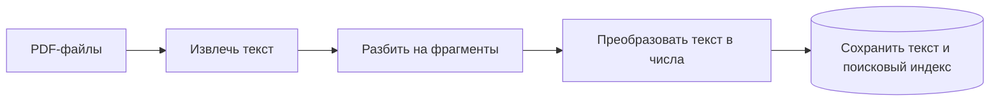
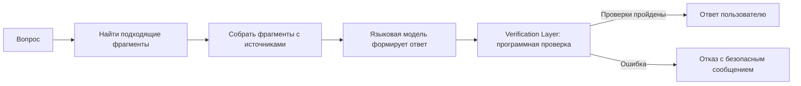
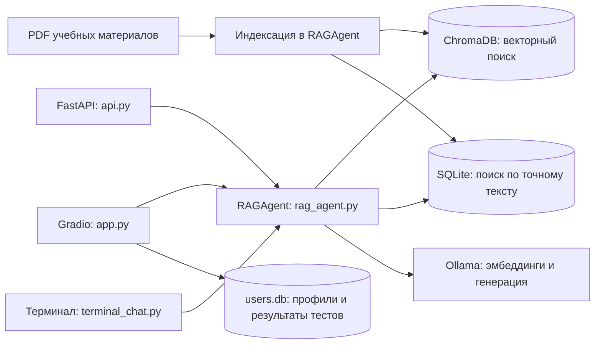

# English Tutor AI

Локальный учебный помощник по английскому языку. Программа ищет информацию в PDF (Portable Document Format — формат электронных документов) из каталога `data/documents`, передает найденные фрагменты языковой модели (программе искусственного интеллекта, которая создает текст) Ollama (программе для запуска таких моделей на своем компьютере) и показывает ответ или тест. Материалы и запросы остаются на компьютере, если Ollama запущена локально.

## Как устроен проект

### Простая схема: что делает агент

Здесь «агент» — программа, которая соединяет поиск по учебным материалам с языковой моделью. Это не самостоятельный человекоподобный помощник: агент выполняет заданные шаги. Сначала документы индексируются (текст делится на части и сохраняется в форме, удобной для поиска), затем для каждого вопроса выбираются подходящие фрагменты, и только после этого модель составляет ответ.

**Подготовка материалов (обычно один раз, затем при добавлении PDF):**



| Этап | Для чего нужен | Что получается |
|---|---|---|
| Прочитать PDF | Получить текст страниц из учебных файлов. | Текст с указанием файла и страницы. |
| Разбить текст | Искать небольшие подходящие части, а не передавать модели всю библиотеку. | Короткие текстовые фрагменты. |
| Посчитать эмбеддинг (числовой вектор, описывающий смысл текста) | Находить фрагменты по смыслу, даже если слова в вопросе отличаются. | Набор чисел для каждого фрагмента. |
| Сохранить индекс | Не перечитывать и не пересчитывать PDF при каждом вопросе. | Текст в SQLite (встроенной базе данных) и векторы с метаданными (сведениями об источнике и странице) в ChromaDB (базе для хранения и смыслового поиска по векторам). |

Контекст (короткая подборка найденных фрагментов, которую модель читает перед ответом) помогает ей отвечать по материалам проекта. **Обработка вопроса пользователя:**



| Этап | Для чего нужен | Что получается |
|---|---|---|
| Получить вопрос | Понять, что нужно объяснить или найти. | Текст запроса. |
| Найти материалы | Выполнить точный поиск по словам и смысловой поиск (поиск фрагментов, близких по значению, даже если формулировки отличаются). | Несколько фрагментов, подходящих к вопросу. |
| Собрать контекст | Передать модели только найденные материалы вместе с именами файлов и страницами. | Ограниченный контекст для ответа. |
| Сгенерировать ответ | Попросить Ollama объяснить найденный материал простым языком и вернуть утверждения с цитатами в JSON (структурированном текстовом формате с полями). | Черновик, который еще не показывается пользователю. |
| Проверить ответ | Проверить цитаты, ID источников, выводимость утверждений NLI (Natural Language Inference — модельная проверка, следует ли вывод из текста), а также согласованность трех генераций. | Подтвержденный ответ либо безопасный отказ. |

В итоге каждый этап подготавливает данные следующему: поиск выбирает источники, контекст даёт модели опору для ответа, а Verification Layer (слой постгенерационной проверки) не выпускает черновик к пользователю, пока код не проверит цитаты, факты и формат. Эта схема называется RAG (Retrieval-Augmented Generation — генерация ответа с дополнением его найденными материалами).

В следующей схеме используются названия программных библиотек: Gradio (средство для создания веб-интерфейса) и FastAPI (средство для создания веб-API — точек, через которые другие программы обращаются к приложению по HTTP, протоколу обмена данными в интернете). RAGAgent — центральный класс проекта: он связывает поиск по базам с вызовами Ollama.



### Основные компоненты

| Компонент | Файл или каталог | Назначение |
|---|---|---|
| Gradio-интерфейс | `app.py` | Вход по имени, чат с репетитором, тесты и история результатов. |
| RAG-агент | `rag_agent.py` | Читает PDF, ищет фрагменты, отправляет контекст в Ollama, разбирает и проверяет ответы и вопросы теста. |
| Verification Layer | `verification.py` | Проверяет структурированный ответ, дословные цитаты, соответствие утверждений источнику с помощью NLI, ID источников, число вопросов и согласованность трех ответов. Записывает отказы в `data/verification_failures.jsonl`. |
| Настройки | `config.py` | Пути к документам и базам, адрес Ollama и имена моделей; значения можно переопределить через `.env`. |
| REST API (веб-интерфейс, через который другие программы обмениваются данными с приложением) | `api.py` | Точки входа для статуса, вопросов, поиска, тестов и переиндексации. |
| База пользователей | `database.py`, `users.db` | Хранит имена пользователей, общие баллы и историю тестов. |
| Терминальный чат | `terminal_chat.py` | Текстовый чат и команды для работы в терминале. |
| Переиндексация | `reindex.py` | Пересоздает индекс документов. Перед запуском см. предупреждение ниже. |
| Учебные материалы | `data/documents/{communication,grammar,reading,vocabulary}` | PDF, которые попадут в базу знаний. |
| Векторная база | `chroma_db/` | Постоянно хранящиеся эмбеддинги и метаданные фрагментов для смыслового поиска. |
| Лексическая база (хранилище для точного поиска слов и фраз) | `data/lexical.db` | SQLite-таблица текстовых фрагментов для поиска совпадений. |

### Как проходит вопрос в чате

1. `RAGAgent` получает несколько близких фрагментов из ChromaDB по эмбеддингу запроса.
2. В найденных фрагментах сохраняются имя PDF, номер страницы и категория.
3. Агент собирает контекст со стабильным `source_id` (ID найденного фрагмента ChromaDB; это не номер, придуманный моделью) и отправляет его вместе с вопросом в Ollama (`/api/generate`).
4. Модель формирует три черновых JSON-ответа с разной температурой генерации; каждый состоит из отдельных утверждений, английской формулировки того же смысла и дословной цитаты.
5. Код проверяет, что `source_id` действительно был среди найденных фрагментов, цитата дословно есть в этом фрагменте, а утверждение следует из цитаты по оценке NLI не ниже 0.70. Дополнительно проверяется, что русский текст сохраняет смысл английской формулировки и что три ответа согласуются между собой.
6. Только прошедшие все проверки утверждения получают имя файла и страницу из метаданных. При любой ошибке интерфейс показывает безопасный отказ, а подробность записывается в `data/verification_failures.jsonl`.

Эмбеддинг — это числовое представление текста, позволяющее искать близкие по смыслу фрагменты, даже если в вопросе нет тех же слов. Поэтому используются два поиска: точный текстовый и смысловой.

### Как строится индекс PDF

При первом запуске приложение проверяет, есть ли записи в коллекции ChromaDB. Если коллекция пуста, оно проходит по PDF во всех четырех категориях. Текст извлекается постранично; затем каждая строка PDF рассматривается как отдельный фрагмент, а строки короче 40 символов пропускаются. Для каждого оставшегося фрагмента создаются эмбеддинг и метаданные источника, которые сохраняются в ChromaDB и SQLite.

Индексирование требует запущенную Ollama и модель эмбеддингов. Сканируются текстовые слои PDF; OCR (оптическое распознавание текста на изображениях) в проекте не реализовано.

### Как строится тест

Для выбранной темы агент ищет содержательные фрагменты по смыслу. Если тема содержит название категории, поиск ограничивается соответствующей категорией. Ollama должна вернуть JSON-массив ровно запрошенной длины; каждый вопрос содержит четыре варианта, один ключ правильного ответа, стабильный `source_id`, цитату и смысловые формулировки для NLI-проверки. При несовпадении длины или ошибке верификации агент делает один строгий повтор; при повторном провале возвращает пустой список. Gradio показывает только прошедшие проверки вопросы. Завершенный результат сохраняется в `users.db`.

## Требования

- Python 3.10 или новее.
- Docker (средство запуска изолированных контейнеров) с Docker Compose (инструмент для запуска сервисов из файла настроек) **или** отдельно установленная Ollama.
- Достаточно памяти для выбранной модели Ollama. Генерация может занимать заметное время.
- При первом ответе/тесте дополнительно загружается мультиязычная ONNX-модель NLI (~339 МБ) с Hugging Face; для этого шага нужен доступ к интернету. Далее используется локальный кэш Hugging Face.
- PDF-материалы в `data/documents/`.

`PyMuPDF` необходим для импорта `fitz` и чтения PDF. Он добавлен в `requirements.txt`; без него агент не запускается.

## Установка и запуск

Инструкции ниже приведены для macOS/Linux. Для Windows используйте `py -m venv .venv`, `.venv\Scripts\activate` и `py` вместо `python3`.

### 1. Запустите Ollama

Из корня проекта запустите только сервис Ollama из `docker-compose.yml`:

```bash
docker compose up -d ollama
```

Загрузите обе модели, которые указаны по умолчанию в `config.py`:

`qwen2.5:7b-instruct-q4_K_M` — модель для создания ответов и тестов; `nomic-embed-text` — модель, которая преобразует запросы и фрагменты PDF в эмбеддинги (числовые представления смысла текста).

```bash
docker exec -it ollama ollama pull qwen2.5:7b-instruct-q4_K_M
docker exec -it ollama ollama pull nomic-embed-text
```

Первая модель генерирует ответы и тесты; вторая преобразует запросы и фрагменты PDF в эмбеддинги. Проверьте, что Ollama отвечает:

```bash
curl http://localhost:11434/api/tags
```

Если Ollama установлена непосредственно в системе, запустите ее обычным для вашей ОС способом и выполните `ollama pull ...` для каждой модели. Адрес, имена моделей и другие настройки можно переопределить переменными `OLLAMA_BASE_URL`, `LLM_MODEL` и `EMBEDDING_MODEL` в `.env`.

### 2. Подготовьте Python-окружение

Команды нужно выполнять в корне проекта. Создайте новое окружение для вашей ОС; приложенный каталог `venv`, если он есть, может быть создан на другой платформе и не подходит для повторного использования.

```bash
python3 -m venv .venv
source .venv/bin/activate
python -m pip install --upgrade pip
python -m pip install -r requirements.txt
```

### 3. Запустите приложение

Основной пользовательский интерфейс:

```bash
python app.py
```

Откройте `http://127.0.0.1:7860`. При первом запуске пустая база знаний индексируется автоматически, поэтому до запуска приложения Ollama и модель `nomic-embed-text` должны быть доступны. Следующие запуски используют уже сохраненную коллекцию.

Запустить REST API вместо Gradio можно так:

```bash
python api.py
```

API будет доступно на `http://127.0.0.1:8000`, интерактивная документация — `http://127.0.0.1:8000/docs`. В API реализованы `GET /`, `POST /ask`, `POST /search`, `POST /quiz` и `POST /reindex`; у `/quiz` сейчас есть дефект: он вызывает отсутствующий метод `generate_quiz`, поэтому запрос завершится ошибкой. Не публикуйте API в общую сеть: в проекте нет аутентификации, а `/reindex` удаляет текущий индекс перед созданием нового.

Терминальный чат:

```bash
python terminal_chat.py
```

Обычные сообщения в чате обрабатываются агентом. Команды `/quiz` и `/upload` пока вызывают методы, которых нет в `RAGAgent`, и не работают.

## Поиск и API

Примеры запросов:

```bash
curl http://localhost:8000/
curl -X POST http://localhost:8000/ask \
  -H 'Content-Type: application/json' \
  -d '{"question":"Что такое Present Simple?"}'
curl -X POST http://localhost:8000/search \
  -H 'Content-Type: application/json' \
  -d '{"query":"irregular verbs","top_k":5}'
```

Сейчас параметр `top_k` в `/search` принимается, но не передается в методы поиска, поэтому изменение этого параметра не меняет число результатов.

## Данные и обслуживание

- PDF лежат в `data/documents/` и не изменяются индексатором.
- PDF-файлы учебных материалов, локальные базы пользователей и поисковые индексы не включены в публичный репозиторий. Добавьте материалы, на распространение которых у вас есть права, в подпапки `data/documents/` перед первым запуском.
- Индекс ChromaDB хранится в `chroma_db/`; лексические записи — в `data/lexical.db`.
- Пользователи и результаты тестов хранятся в `users.db`.
- `words.db` и `users_progress.db` не используются основными потоками приложения.
- Чтобы добавить материал, положите PDF в папку подходящей категории.
- Для обновления индекса можно запустить `python reindex.py` или вызвать API `POST /reindex`.

**Важно:** переиндексация сейчас сначала удаляет прежнюю коллекцию ChromaDB и очищает таблицу SQLite, а затем обрабатывает файлы. Если Ollama отключится или один из PDF вызовет ошибку, старый индекс не восстановится, а новый может оказаться неполным. Перед переиндексацией сохраните копии `chroma_db/` и `data/lexical.db` и убедитесь, что Ollama работает.

## Верификация результатов

NLI-модель `MoritzLaurer/mDeBERTa-v3-base-mnli-xnli` запускается локально через ONNX Runtime; она оценивает пару «цитата-утверждение». Порог 0.70 намеренно настроен на отказ при неуверенности, поэтому проверка может отклонять полезный, но свободно перефразированный ответ. Это ограничение безопаснее, чем показывать неподтвержденный текст. Лог отказов содержит тип (`unsupported_claim`, `internal_contradiction`, `bad_citation`, `wrong_count`, `citation_drift`) и техническую причину.

NLI — вероятностная проверка, а не формальное доказательство истинности. Три ответа могут повторить одну и ту же ошибку, а проверка правильности вариантов зависит от того, достаточно ли конкретна цитата. Перед использованием в обучении всё равно полезна выборочная ручная проверка материалов и отказов.

## Текущие ограничения

- Gradio использует глобальные переменные для текущего пользователя и теста, поэтому несколько одновременных сессий могут перезаписывать профиль и состояние теста друг друга. Интерфейс предназначен для локального одиночного использования.
- Вход по имени не является аутентификацией: имя можно выбрать произвольно.
- Индексация хранит каждую достаточно длинную строку PDF как отдельный фрагмент; контекст между соседними строками может теряться.
- Поиск и генерация зависят от Ollama и локально загруженных моделей.
- Верификатор работает с утверждениями, выделенными самой языковой моделью; ошибки разбиения сложного предложения на утверждения могут привести к отказу или пропуску факта.
- Если NLI-модель недоступна или не может быть загружена, проверка закрывается безопасным отказом, а не показом сырого ответа.
- Переиндексация неатомарна и не сохраняет прежний индекс при ошибках.
- REST API блокирующе вызывает сетевые и файловые операции внутри `async`-обработчиков; при долгом запросе остальные запросы могут ждать.

## Структура проекта

```text
.
├── app.py                 # интерфейс Gradio
├── api.py                 # REST API
├── rag_agent.py           # чтение PDF, поиск и генерация
├── config.py              # настройки и пути
├── database.py            # база пользователей и результатов тестов
├── reindex.py             # ручная переиндексация
├── terminal_chat.py       # интерфейс командной строки
├── requirements.txt       # Python-зависимости
├── docker-compose.yml     # контейнер Ollama
├── data/
│   ├── documents/         # учебные PDF по категориям
│   └── lexical.db         # индекс текстового поиска
└── chroma_db/             # постоянный векторный индекс
```

## История изменений

| Дата | Изменения |
|---|---|
| 2026-11-15 | Добавлен Verification Layer для чата и тестов: структурированный JSON, проверка атомарных утверждений и цитат мультиязычной NLI-моделью, самосогласованность трех вариантов ответа, точная длина теста, проверка ID источников и единственного правильного варианта, строгий повтор и безопасный отказ. NLI сверяет утверждение с цитатой на языке источника и берет ограниченный контекст вокруг нее. Поиск тестов расширяет найденные строки PDF до страницы, отбрасывает общие инструкции упражнений и ранжирует теоретические материалы выше; в чате сокращено количество страниц контекста. Добавлено логирование причин отказа в JSONL. `source_id` теперь стабилен и берется из ID фрагмента ChromaDB, источник/страницу подставляет программа. Проверено: тест на Present Simple вернул ровно один вопрос по PDF-теории и прошел NLI-проверку; ошибочная генерация приводит к безопасному отказу. Обновлена документация и это описание работы. |
